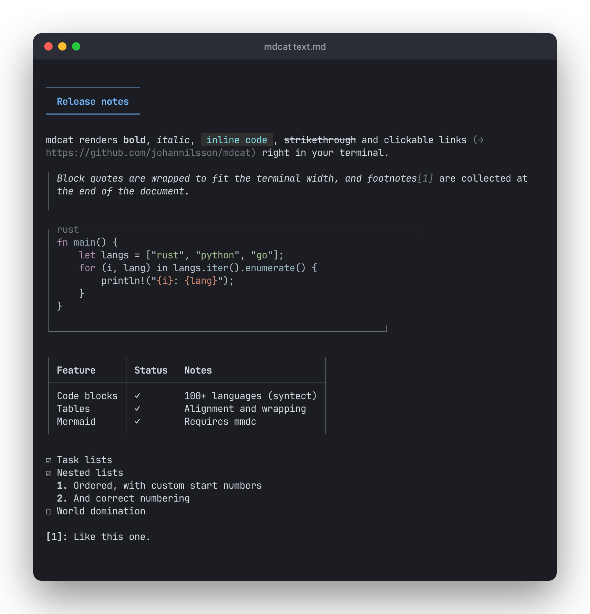
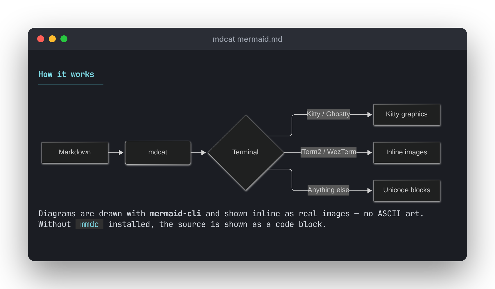

# mdcat

`cat` for Markdown. Render formatted Markdown in the terminal, with syntax
highlighting, tables, inline images, and real Mermaid diagrams.



```bash
mdcat README.md
cat notes.md | mdcat
mdcat --pager long-doc.md
```

## Features

- **GitHub Flavored Markdown**: headings, emphasis, strikethrough, block
  quotes, tables with column alignment, task lists, nested and ordered lists,
  and footnotes
- **Syntax highlighting** for fenced code blocks, via
  [syntect](https://github.com/trishume/syntect)
- **Clickable links** using OSC 8 hyperlinks, with the URL shown alongside
- **Inline images** (PNG, JPEG, GIF, WebP and SVG) using the best protocol
  your terminal supports
- **Mermaid diagrams** rendered as images, not ASCII art
- **Built-in pagers** that keep images intact while you scroll
- Word-wraps to the terminal width



## Install

mdcat is not on crates.io yet. Build it from source with a recent Rust toolchain:

```bash
git clone https://github.com/johannilsson/mdcat
cd mdcat
cargo install --path .
```

To load images from `http(s)://` URLs, enable the `network-images` feature:

```bash
cargo install --path . --features network-images
```

### Mermaid diagrams (optional)

Mermaid support uses [mermaid-cli](https://github.com/mermaid-js/mermaid-cli):

```bash
npm install -g @mermaid-js/mermaid-cli
```

If `mmdc` isn't on your `PATH`, diagrams are shown as code blocks with an
install hint. Use `--mermaid-binary` or `MMDC_PATH` to point at a binary
somewhere else.

## Terminal support

mdcat detects your terminal and picks an image protocol automatically:

| Terminal         | Images                      | Pager                          |
|------------------|-----------------------------|--------------------------------|
| Kitty, Ghostty   | Kitty graphics protocol     | Image-aware pager              |
| iTerm2, WezTerm  | iTerm2 inline images        | Text pager, images shown as alt text |
| Anything else    | Unicode half-block approximation | Text pager                |

Override detection with `--image-protocol kitty|iterm2|blocks`, or turn
images off with `--no-images`.

## Paging

Pass `--pager` to scroll through long documents. You can also symlink
`mdless` to `mdcat`, and pager mode turns on automatically when invoked under
that name:

```bash
ln -s "$(which mdcat)" ~/.local/bin/mdless
mdless README.md
```

In Kitty and Ghostty, mdcat uses its own pager
([`kitty-pager`](kitty-pager/README.md)), which keeps images and diagrams in
place as you scroll. Keys: `j`/`k` or arrows to scroll, `Ctrl-D`/`Ctrl-B` for
half pages, `PgDn`/`PgUp`, `g`/`G` for top and bottom, and `q` to quit.

In other terminals, mdcat uses the [minus](https://github.com/arijit79/minus)
pager, which supports `/` search. Graphics escape sequences don't survive
that pager, so images and diagrams fall back to their alt text or source.

## Options

| Option                      | Description                                                   |
|-----------------------------|---------------------------------------------------------------|
| `--pager`                   | Page the output                                               |
| `--width <N>`               | Wrap at `N` columns instead of the detected width (`COLUMNS`) |
| `--theme <NAME>`            | Syntax highlighting theme (default `base16-ocean.dark`)       |
| `--no-images`               | Don't render images                                           |
| `--no-mermaid`              | Show Mermaid blocks as code                                   |
| `--mermaid-binary <PATH>`   | Path to `mmdc` (`MMDC_PATH`)                                  |
| `--image-protocol <NAME>`   | `auto`, `kitty`, `iterm2` or `blocks`                         |

Built-in themes: `base16-ocean.dark`, `base16-eighties.dark`,
`base16-mocha.dark`, `base16-ocean.light`, `InspiredGitHub`,
`Solarized (dark)` and `Solarized (light)`.

Run `mdcat --help` for the full list.

## Development

```bash
cargo build
cargo test
cargo clippy --all-features -- -D warnings
cargo run -- test.md
```

Design decisions are recorded in [`docs/adr`](docs/adr).

The screenshots are generated from the Markdown in
[`docs/screenshots`](docs/screenshots) by replaying mdcat's output in
xterm.js inside headless Chromium. To regenerate them (needs Node and `mmdc`):

```bash
cargo build --release
cd docs/screenshots
npm ci
npx playwright install chromium
npm run shoot
```

## License

MIT
